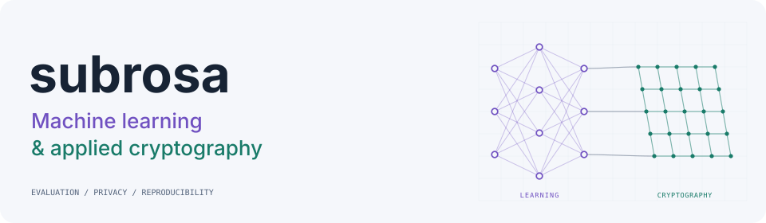

<picture>
  <source media="(prefers-color-scheme: dark)" srcset="./assets/banner-dark.svg">
  <source media="(prefers-color-scheme: light)" srcset="./assets/banner-light.svg">
  
</picture>

I build ML applications and explore applied cryptography, with a focus on evaluation, failure modes, and reproducible experiments.

**Working with** Python · scikit-learn · XGBoost · PostgreSQL / pgvector · Docker · Go

### Selected work

<table>
<tr>
<td width="50%" valign="top">

**01 / MACHINE LEARNING**

### [Evidence-backed RAG](https://github.com/subrosa5/rag-mcp-agent)

Hybrid retrieval, reranking, source checks, and an MCP interface. An evaluation suite covers answers and refusals.

`Python` `pgvector` `RAG` `MCP`

</td>
<td width="50%" valign="top">

**02 / APPLIED CRYPTOGRAPHY**

### [x12 · offline threshold vault](https://github.com/subrosa5/0xc12d5d4abbb8c1bee4a5e4ce)

Streaming encryption, shared key recovery, and a synthetic crash lab. Experimental; no independent security audit.

`AES-GCM` `Shamir` `ML-KEM` `ML-DSA`

</td>
</tr>
<tr>
<td width="50%" valign="top">

**03 / MODEL EVALUATION**

### [Antifraud Detector](https://github.com/subrosa5/antifraud-detector)

Leakage-aware fraud modeling, cost-based evaluation, SHAP analysis, and adversarial robustness experiments.

`scikit-learn` `XGBoost` `SHAP`

</td>
<td width="50%" valign="top">

**04 / SYSTEMS**

### [Distributed KV Store](https://github.com/subrosa5/distributed-kv-store)

A Go implementation of Raft with a write-ahead log, crash recovery, and a cluster dashboard.

`Go` `Raft` `WAL`

</td>
</tr>
</table>

### Exploring

Privacy-preserving ML · encrypted inference · post-quantum protocols

[More projects](https://github.com/subrosa5?tab=repositories)

Εν οίδα ότι ουδέν οίδα
